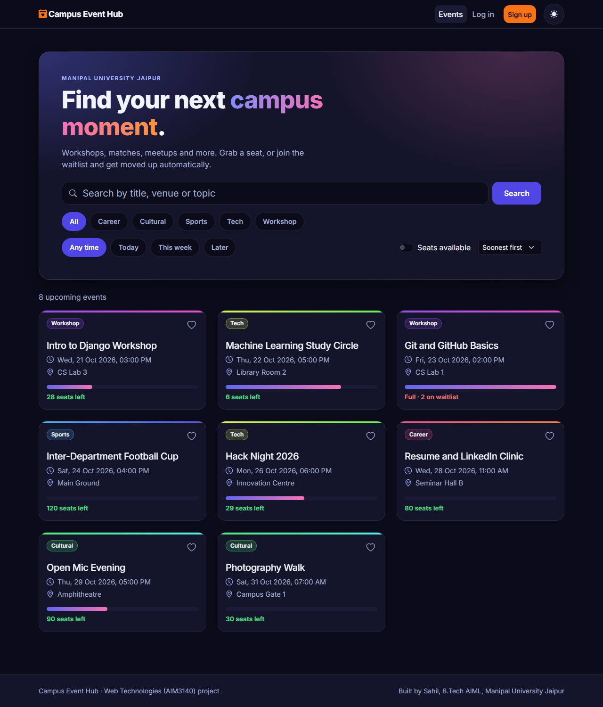
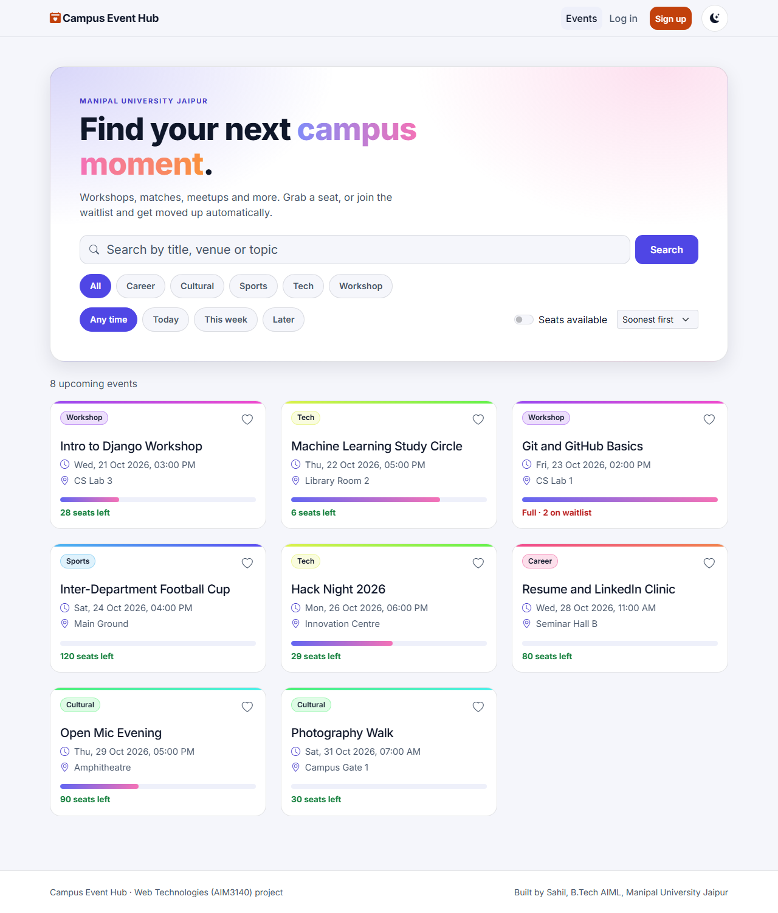
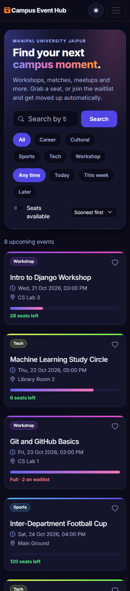
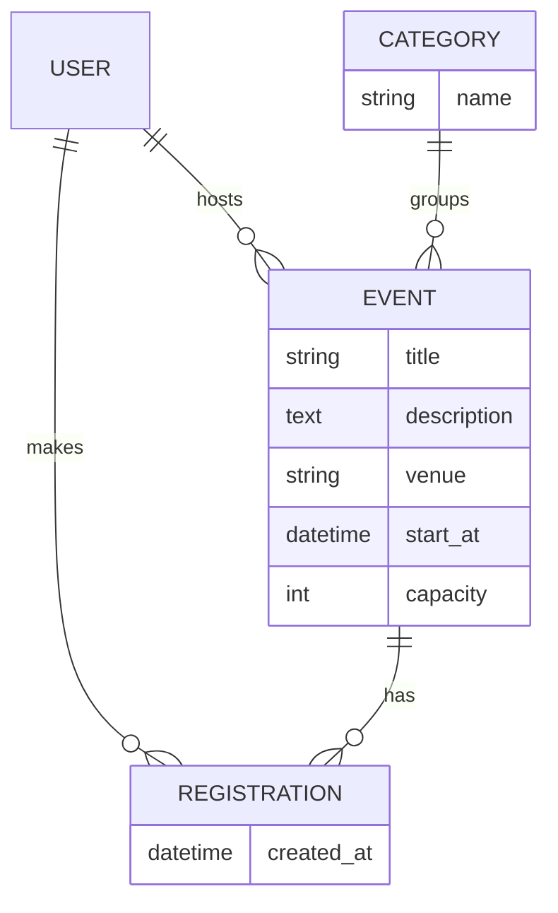

# Campus Event Hub

A web app where students find campus events, register for a seat, and host their own events. Built for the **Web Technologies (AIM3140)** project, B.Tech AIML, Manipal University Jaipur.

**Author:** Sahil
**Live site:** https://campus-event-hub-lake.vercel.app
**Source code:** https://github.com/Sahil-u07/campus-event-hub

| Dark | Light |
|---|---|
|  |  |

On a phone (375px wide):



## What it does

**For students**
- Browse upcoming events with a seat meter on every card.
- Live search with no page reload. Filter by category and by when (today, this week, later), show only events with seats, and sort by soonest or most popular. The filters stay in the URL, so a filtered view can be shared. Results load nine at a time with a "Load more" button.
- Register with one click. If an event is full you join the **waitlist** and see your position. When someone cancels, the first person on the waitlist is confirmed automatically.
- Save events with a heart button, see them on the Saved page, and download an `.ics` file to add an event to any calendar. (Events have no end time, so the calendar entry is two hours long.)
- "My events" shows what you are going to, your waitlist positions and what you host.
- Dark and light themes. The first visit follows your system setting and the toggle remembers your choice.

**For hosts**
- Host an event. Only the creator can edit or delete it. Raising the capacity moves people up from the waitlist.
- Attendee dashboard with a live check-in switch for each person, waitlist view and a CSV download. Usernames that start with `=`, `+`, `-` or `@` are escaped in the CSV so a spreadsheet cannot run them as formulas.

**For admins**
- Django admin for categories, events, registrations (with status and check-in) and saved events.

Rules the server enforces: no double registration, no registering for a past event, the last seat goes to one person even when two click at once (the event row is locked inside a transaction), capacity cannot go below the number already confirmed, and events cannot be created in the past.

## Tech stack

| Layer | Used |
|---|---|
| Front end | HTML5, CSS3, Bootstrap 5 (grid, navbar, cards, forms), JavaScript, jQuery |
| Back end | Python 3, Django 5 (MVT) |
| Database | MySQL (local), PostgreSQL (hosted), accessed only through the Django ORM |
| Hosting | GitHub, Vercel |

## How it maps to the syllabus

| Syllabus topic | Where it is in the project |
|---|---|
| HTML tags, lists, tables, links, navigation | Templates in `events/templates/` (event cards, "My events" tables, navbar, breadcrumbs) |
| HTML forms and input handling | Sign up, log in, host/edit event forms (`events/forms.py`), with server-side validation |
| CSS: external styling | `events/static/css/site.css` |
| JavaScript: events, functions, DOM | `events/static/js/site.js` builds event cards and updates seat counts and buttons |
| Bootstrap grid and responsive design | `row` / `col-*` layout, collapsing navbar, works from phone width up |
| Python for the web, GET/POST | GET for search and pages, POST for forms and register/cancel (`events/views.py`) |
| MySQL and CRUD | `sql/schema.sql`, Django runs on MySQL when `DB_NAME` is set |
| JSON and AJAX with jQuery | `GET /api/events/` and `POST /api/events/<id>/register/` return JSON, jQuery updates the page |
| Django MVT, models, views, templates | `models.py`, `views.py`, `templates/` |
| Admin interface | `events/admin.py` with search, filters and date drill-down |
| Django ORM | All queries use the ORM (`filter`, `annotate`, `select_related`, `UniqueConstraint`) |
| URL routing | `events/urls.py` and `campushub/urls.py` |

NodeJS and AngularJS from the syllabus are not used in this project.

## Database design



`Registration` has a unique pair (event, user), so one person cannot take two seats. Its `status` is `confirmed` or `waitlisted`, and `checked_in` is set by the host. `SavedEvent` links a user to an event they saved, also unique per pair.

## Pages and API

| URL | Purpose |
|---|---|
| `/` | Event list with search and category filter |
| `/events/<id>/` | Event details and register/cancel button |
| `/events/new/`, `/events/<id>/edit/`, `/events/<id>/delete/` | Host, edit, delete (owner only) |
| `/mine/` | Going, waitlist and hosted events |
| `/saved/` | Saved events |
| `/events/<id>/attendees/` | Host dashboard with check-in (owner only) |
| `/events/<id>/attendees.csv` | CSV download (owner only) |
| `/events/<id>/calendar.ics` | Add to calendar |
| `/signup/`, `/login/`, `/logout/` | Accounts |
| `/admin/` | Admin panel |
| `GET /api/events/?q=&category=&when=&available=1&sort=&page=` | JSON `{events, total, has_next, page}` |
| `POST /api/events/<id>/save/` | Toggle saved, JSON `{"saved": true}` |
| `POST /api/registrations/<id>/checkin/` | Host only, toggles check-in, JSON `{"checked_in": true}` |
| `POST /api/events/<id>/register/` | JSON `{"state": "confirmed" or "waitlisted", "seats_left": 4, "position": 0}` |
| `POST /api/events/<id>/cancel/` | JSON `{"state": "none", "seats_left": 5, "position": 0}` |

Errors come back as JSON `{"error": "..."}` with status 400, or 401 if not logged in. POST requests carry the CSRF token.

## Run it on your computer

You need Python 3.10 or newer.

```bash
git clone https://github.com/Sahil-u07/campus-event-hub.git
cd campus-event-hub
python -m venv .venv
.venv\Scripts\activate        # Windows. On Mac/Linux: source .venv/bin/activate
pip install -r requirements.txt
python manage.py migrate
python manage.py seed_demo    # adds sample events
python manage.py createsuperuser   # optional, for /admin/
python manage.py runserver
```

Open http://127.0.0.1:8000/. With no settings changed it uses a local SQLite file so it runs anywhere.

**Using MySQL** (as in the syllabus): create an empty database called `campushub`, set these environment variables, then run `migrate` as above.

```bash
set DB_NAME=campushub
set DB_USER=root
set DB_PASSWORD=your-password
set DB_HOST=127.0.0.1
```

**Tests:** `python manage.py test` (58 tests: registration and waitlist rules, JSON API, filters and paging, saved events, calendar file, host dashboard and CSV, permissions, forms; they run on in-memory SQLite).

## Deployment (Vercel)

Vercel finds `manage.py` and runs the project as a serverless function. Its disk is read-only, so the hosted site uses a PostgreSQL database instead of SQLite or MySQL. The code switches database by environment variable:

| Variable | Value |
|---|---|
| `POSTGRES_URL` (or `DATABASE_URL`) | Connection string of the hosted PostgreSQL database. The Supabase integration on Vercel sets it automatically |
| `SECRET_KEY` | A long random string |
| `CSRF_TRUSTED_ORIGINS` | `https://campus-event-hub-lake.vercel.app` |

`DEBUG` is off automatically on Vercel. `vercel.json` runs `migrate` and `seed_demo` on every deploy, so the tables and the sample events are created in the hosted database without any manual step (`seed_demo` skips events that already exist).

Steps: push the repo to GitHub, import it at vercel.com/new, add a Supabase PostgreSQL database from the Vercel Storage tab (this sets `POSTGRES_URL` for you), add `SECRET_KEY` and `CSRF_TRUSTED_ORIGINS`, then deploy.

## Known limits

- Free hosting can be slow on the first request after idle time.
- There are no email notifications, so waitlist promotions show up on the site only.
- Events have no poster images, because the hosting disk is read-only.
