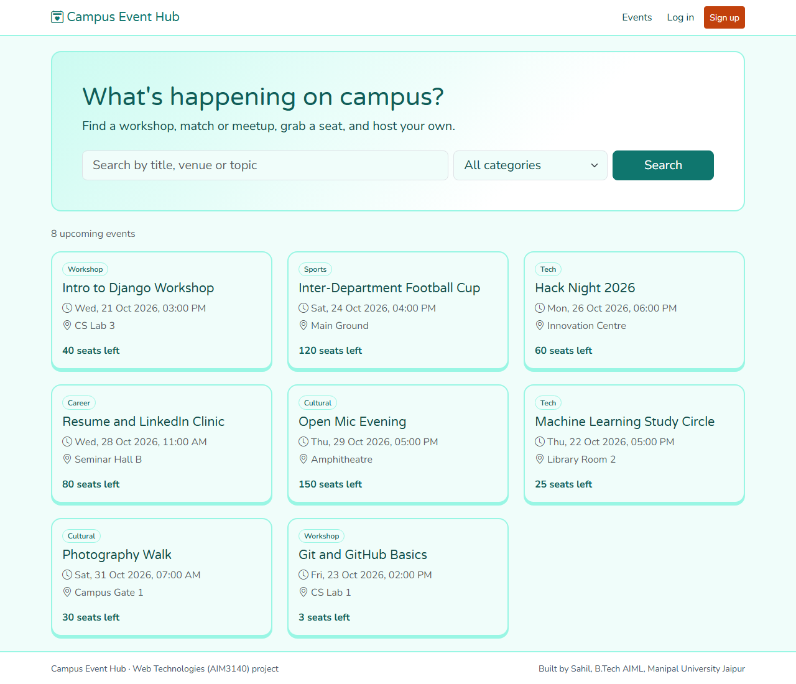
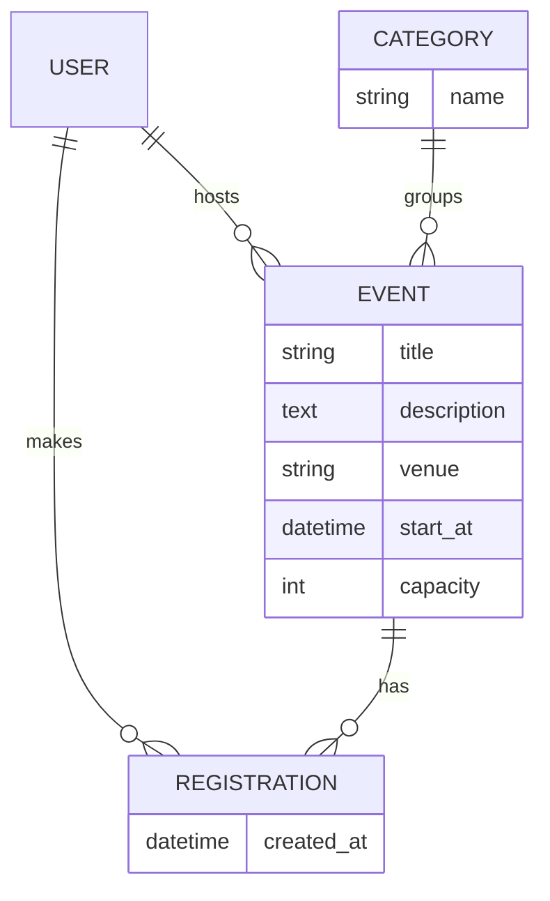

# Campus Event Hub

A web app where students find campus events, register for a seat, and host their own events. Built for the **Web Technologies (AIM3140)** project, B.Tech AIML, Manipal University Jaipur.

**Author:** Sahil
**Live site:** LIVE_URL_HERE
**Source code:** https://github.com/Sahil-u07/campus-event-hub



## What it does

- Browse upcoming events and see how many seats are left.
- Search by title, venue or topic, and filter by category. Results update as you type, without a page reload.
- Sign up, log in, and register for or cancel a seat with one click. The seat count updates instantly.
- Host an event. Only the person who created an event can edit or delete it.
- "My events" page shows what you are going to and what you host.
- Django admin panel for managing categories, events and registrations.

Rules the server enforces: no double registration, no registering for a full or past event, capacity cannot be set below the number already registered, and events cannot be created in the past.

## Tech stack

| Layer | Used |
|---|---|
| Front end | HTML5, CSS3, Bootstrap 5 (grid, navbar, cards, forms), JavaScript, jQuery |
| Back end | Python 3, Django 5 (MVT) |
| Database | MySQL (local), PostgreSQL (hosted), accessed only through the Django ORM |
| Hosting | GitHub, Vercel |

## How it maps to the syllabus

| Syllabus topic | Where it is in the project |
|---|---|
| HTML tags, lists, tables, links, navigation | Templates in `events/templates/` (event cards, "My events" tables, navbar, breadcrumbs) |
| HTML forms and input handling | Sign up, log in, host/edit event forms (`events/forms.py`), with server-side validation |
| CSS: external styling | `events/static/css/site.css` |
| JavaScript: events, functions, DOM | `events/static/js/site.js` builds event cards and updates seat counts and buttons |
| Bootstrap grid and responsive design | `row` / `col-*` layout, collapsing navbar, works from phone width up |
| Python for the web, GET/POST | GET for search and pages, POST for forms and register/cancel (`events/views.py`) |
| MySQL and CRUD | `sql/schema.sql`, Django runs on MySQL when `DB_NAME` is set |
| JSON and AJAX with jQuery | `GET /api/events/` and `POST /api/events/<id>/register/` return JSON, jQuery updates the page |
| Django MVT, models, views, templates | `models.py`, `views.py`, `templates/` |
| Admin interface | `events/admin.py` with search, filters and date drill-down |
| Django ORM | All queries use the ORM (`filter`, `annotate`, `select_related`, `UniqueConstraint`) |
| URL routing | `events/urls.py` and `campushub/urls.py` |

NodeJS and AngularJS from the syllabus are not used in this project.

## Database design



`Registration` has a unique pair (event, user), so one person cannot take two seats.

## Pages and API

| URL | Purpose |
|---|---|
| `/` | Event list with search and category filter |
| `/events/<id>/` | Event details and register/cancel button |
| `/events/new/`, `/events/<id>/edit/`, `/events/<id>/delete/` | Host, edit, delete (owner only) |
| `/mine/` | My registrations and hosted events |
| `/signup/`, `/login/`, `/logout/` | Accounts |
| `/admin/` | Admin panel |
| `GET /api/events/?q=&category=` | JSON list of upcoming events |
| `POST /api/events/<id>/register/` | JSON `{"registered": true, "seats_left": 4}` |
| `POST /api/events/<id>/cancel/` | JSON `{"registered": false, "seats_left": 5}` |

Errors come back as JSON `{"error": "..."}` with status 400, or 401 if not logged in. POST requests carry the CSRF token.

## Run it on your computer

You need Python 3.10 or newer.

```bash
git clone https://github.com/Sahil-u07/campus-event-hub.git
cd campus-event-hub
python -m venv .venv
.venv\Scripts\activate        # Windows. On Mac/Linux: source .venv/bin/activate
pip install -r requirements.txt
python manage.py migrate
python manage.py seed_demo    # adds sample events
python manage.py createsuperuser   # optional, for /admin/
python manage.py runserver
```

Open http://127.0.0.1:8000/. With no settings changed it uses a local SQLite file so it runs anywhere.

**Using MySQL** (as in the syllabus): create an empty database called `campushub`, set these environment variables, then run `migrate` as above.

```bash
set DB_NAME=campushub
set DB_USER=root
set DB_PASSWORD=your-password
set DB_HOST=127.0.0.1
```

**Tests:** `python manage.py test` (24 tests: registration rules, JSON API, permissions, forms; they run on in-memory SQLite).

## Deployment (Vercel)

Vercel finds `manage.py` and runs the project as a serverless function. Its disk is read-only, so the hosted site uses a PostgreSQL database instead of SQLite or MySQL. The code switches database by environment variable:

| Variable | Value |
|---|---|
| `DATABASE_URL` | Connection string of the hosted PostgreSQL database |
| `SECRET_KEY` | A long random string |
| `CSRF_TRUSTED_ORIGINS` | `https://<your-project>.vercel.app` |

`DEBUG` is off automatically on Vercel. After the first deploy, run `python manage.py migrate` and `python manage.py seed_demo` once against that database.

## Known limits

- Free hosting can be slow on the first request after idle time.
- Registration is first come, first served. There is no waiting list or email confirmation.
- Events have no poster images, because the hosting disk is read-only.
